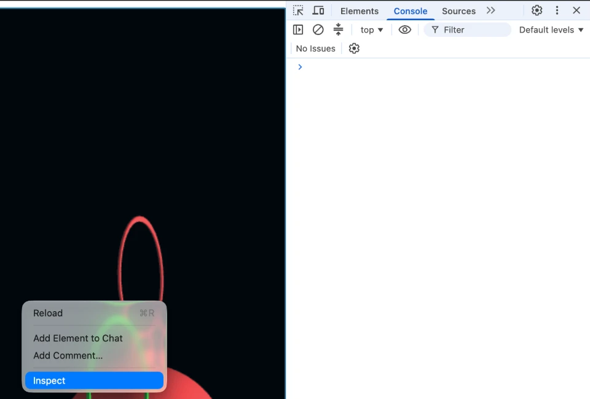

# Running the exercise

We sometimes improve the exercise after it is published. Before you start, pull the latest version of the repository. If you have already started, you can keep working in your own copy.

Open `index.html` through a local web server. If you open the file directly from disk (the address starts with `file://`), the browser blocks the exercise's JavaScript modules and the page only shows an error message.

Use one of these:

- **VS Code:** right-click `index.html` and choose *Open in Integrated Browser*.
- **Python 3:** open a terminal in this folder and run `python3 -m http.server` (use `python` on Windows). Then open http://localhost:8000 in your browser.

  8000 is the port the server uses when you don't name one. To use another port, put its number at the end of the command, for example `python3 -m http.server 8003`. The address then ends in that number too: http://localhost:8003. You need a different port if 8000 is already taken, or if you want two servers running at the same time.

## If a change doesn't show up

Browsers keep copies of the files they load. After you change a file, they sometimes keep using the old copy, so your edit seems to have no effect. The same happens if you keep several copies of the exercise folder to try things out and switch between them on the same port. The browser then runs a mix of old and new files. Giving each copy its own port avoids this.

Turn the cache off before you start working:

- **Chrome, Edge, Firefox, VS Code:** open the developer tools (see *Opening the console* below), go to the *Network* tab and tick "Disable cache". This only works while the developer tools are open, so leave them open while you work. In VS Code's integrated browser, the *Network* tab sits behind the `>>` button.
- **Safari:** choose Develop > Disable Caches. Develop > Empty Caches (Cmd+Option+E) clears the cache once.

# Debugging with the browser console

When something is wrong, WebGL almost never stops your program. A misspelled attribute name or a plain array in `gl.bufferData` usually just leaves the mesh dark or black. The browser does notice the mistake, though, and writes a message to the console. So if the canvas is black or looks wrong, open the console first. It usually tells you which call failed.

## Opening the console

| Browser | macOS | Windows / Linux |
|---|---|---|
| Chrome, Edge | Cmd+Option+J | Ctrl+Shift+J |
| Firefox | Cmd+Option+K | Ctrl+Shift+K |
| Safari | Cmd+Option+C | |

Safari hides its developer tools by default. Turn them on once under Safari > Settings > Advanced > "Show features for web developers".

In VS Code's integrated browser, right-click anywhere on the page and choose *Inspect*. The developer tools open next to the page. Switch to the *Console* tab.



## Reading the console

- **Red lines** are JavaScript errors. The script stops at that line, so nothing after it runs. The file name and line number on the right are links. Click one to jump to the code.
- **Yellow lines starting with `WebGL:`** are warnings. The script keeps running, but the call that caused the warning did nothing.
- **Shader compile errors** show up as a pop-up, because the code calls `alert()` for them.

The `render` function runs about 60 times per second, so a broken call inside it repeats the same warning every frame. Always fix the first message at the top. The others are often follow-up errors.

## Messages you'll likely see in this exercise

This is Chrome's wording. Firefox and Safari say the same thing in slightly different words.

| Message | Usual cause |
|---|---|
| `WebGL: INVALID_VALUE: vertexAttribPointer: index out of range` | `gl.getAttribLocation` returned -1. Either the name doesn't match the shader, or the shader declares the attribute but never uses it. The shader compiler removes unused attributes. |
| `WebGL: INVALID_OPERATION: drawElements: no buffer is bound to enabled attribute` | An attribute is enabled but has no buffer. Bind the buffer, then call `gl.vertexAttribPointer`. |
| `GL_INVALID_OPERATION: glDrawElements: Vertex buffer is not big enough for the draw call.` | A vertex buffer is empty or smaller than the attribute setup says. Usually the data was not wrapped in `new Float32Array(...)`. See the Task 1 hints below. |
| `TypeError: Failed to execute 'uniform4fv' on 'WebGLRenderingContext': The provided value cannot be converted to a sequence.` | The value passed to `gl.uniform4fv` is not an array. Usually the `false` from `gl.uniformMatrix4fv` was copied over. `gl.uniform4fv` has no transpose flag, so call it as `gl.uniform4fv(location, lightPos)`. |
| `TypeError: vec3.substract is not a function` | A typo in a function name. Check the [gl-matrix docs](https://glmatrix.net/docs/). |
| `TypeError: Cannot set properties of undefined (setting '0')` | You write into an array that was never created, for example `mesh.vertexColors[...] = ...` after `const vertexColors = ...`. Those are two different names. Create the array as `mesh.vertexColors = ...`, or use your own variable name everywhere. |
| `ReferenceError: x is not defined` | A typo in a variable name, or the variable is declared in another function. |

## When there is no message

Some mistakes are silent. A misspelled uniform name is the classic one: `gl.getUniformLocation` returns `null`, and setting a `null` uniform does nothing without any warning. In that case print values with `console.log` and check them yourself:

```js
console.log(gl.getAttribLocation(shaderProgram, "aVertexNormal"));     // -1: name is wrong or unused in the shader
console.log(gl.getUniformLocation(shaderProgram, "uModelViewMatrix")); // null: name is wrong
console.log(mesh.vertexNormals.slice(0, 9));                           // first three normals: length 1, no NaN, not all 0
```

Put these before the render loop. Inside `render` they print 60 times per second.

# The mesh object

`new OBJ.Mesh(objStr)` in `main.js` reads the model and returns the object `mesh`. This model has 10377 vertices and 19059 triangles. To look at the object yourself, put `console.log(mesh)` before the render loop and open it in the console.

All the arrays are flat. They hold single numbers, not vectors, so you have to work out where a value sits in the array.

| Property | Contents | Numbers per item | Length |
|---|---|---|---|
| `mesh.vertices` | Vertex positions: `[x0, y0, z0, x1, y1, z1, ...]` | 3 per vertex | 31131 |
| `mesh.vertexNormals` | Vertex normals, with the same layout. At first they come from the file. In Task 2 you replace them with your own. | 3 per vertex | 31131 |
| `mesh.indices` | Triangles, as vertex numbers: `[a0, b0, c0, a1, b1, c1, ...]` | 3 per triangle | 57177 |
| `mesh.vertexColors` | Doesn't exist at the start. You create it in Task 3a: `[r0, g0, b0, a0, r1, ...]` | 4 per vertex | 41508 |

So the number of vertices is `mesh.vertices.length / 3`, and the number of triangles is `mesh.indices.length / 3`.

An entry of `mesh.indices` is a vertex number, not a position in `mesh.vertices`. To get the position of the first corner of triangle `i`, go through both arrays:

```js
var v = mesh.indices[3*i + 0];   // the vertex number of corner 0 of triangle i
var x = mesh.vertices[3*v + 0];  // its x coordinate
var y = mesh.vertices[3*v + 1];  // its y coordinate
var z = mesh.vertices[3*v + 2];  // its z coordinate
```

The helper `vec3FromArray(mesh.vertices, v)` in `main.js` does the last three lines for you and returns a `vec3`.

The loader also adds these properties. The exercise doesn't use them:

- `mesh.textures`: texture coordinates, 2 per vertex.
- `mesh.vertexBuffer`, `mesh.normalBuffer`, `mesh.textureBuffer`, `mesh.indexBuffer`: GPU buffers that `OBJ.initMeshBuffers` fills with the data from the file. `mesh.normalBuffer` holds the file's normals, so don't use it for Task 2.
- `mesh.name`, `mesh.materialNames`, `mesh.materialIndices`, `mesh.materialsByIndex`, `mesh.vertexMaterialIndices`, `mesh.textureStride`: material and loader details.

# Hints and spoilers

If you're stuck, look for what you see on screen in the list below. Each entry opens a hint first. The exact fix sits one level deeper, so try the hint before you open the spoiler.

You can download the script chapter from Moodle: [vc_graphics_WebGL.pdf](https://moodle-app2.let.ethz.ch/pluginfile.php/2649827/mod_folder/content/0/vc_graphics_WebGL.pdf?forcedownload=1).

The blocks only fold up in a Markdown preview. In VS Code, open one with Cmd+Shift+V (macOS) or Ctrl+Shift+V (Windows / Linux).

## Any task

<details>
<summary>I saved a change, but the page looks exactly the same</summary>

The browser is probably still running an old copy of your files. Turn off the cache as described in [If a change doesn't show up](#if-a-change-doesnt-show-up), then reload.

</details>

## Task 1

| Step | You should see |
|---|---|
| Start | Dark, flat baubles. They are hard to see, but that's correct. The shader gets no normals yet. |
| After 1a | Bright, shaded baubles. The light sits at the camera. |
| After 1b | The light comes from the right. The picture gets darker, because most of each bauble is in the shadow. |

<details>
<summary>I don't know where to start</summary>

Task 1 connects your JavaScript to the shaders. `main.js` runs on the CPU and the shaders run on the GPU, so they can't see each other's variables. Open `main.js`, search for `TASK 1a` and read the comment there. The block for the vertex positions is already done. Read it line by line, because the normals work the same way.

<details>
<summary>Spoiler</summary>

Copy the six lines of the `Vertices` block below the `Vertex Normals` comment. Change `mesh.vertices` to `mesh.vertexNormals`, and `"aVertexPosition"` to `"aVertexNormal"`. Normals also have 3 numbers per vertex, so the rest stays the same.

</details>
</details>

<details>
<summary>The baubles stay dark and flat after Task 1a</summary>

The normals don't reach the shader. Open the console first. To check the name, log the attribute location before the render loop:

```js
console.log(gl.getAttribLocation(shaderProgram, "aVertexNormal")); // should be 0 or higher, not -1
```

A -1 means the name doesn't match the shader.

<details>
<summary>Spoiler</summary>

Compare your block with the `Vertices` block line by line. A missing `gl.enableVertexAttribArray` is the usual cause, because it raises no error. Also check that you wrote `mesh.vertexNormals` and `"aVertexNormal"` in the right places.

</details>
</details>

<details>
<summary>The picture got darker after Task 1b</summary>

That is correct. Before Task 1b, `uLightPos` was all zeros, so the light sat at the camera and lit everything you can see. Now it comes from the right, so most of each bauble is in the shadow.

If nothing changed at all, check the string in `gl.getUniformLocation`. A misspelled name sets nothing and shows no warning.

</details>

<details>
<summary>The console shows <code>glDrawElements: Vertex buffer is not big enough for the draw call</code></summary>

Your index buffer is fine, but the indices point to vertices that one of your vertex buffers doesn't have. That buffer is empty, or smaller than your attribute setup says it is. Check the `gl.bufferData` and `gl.vertexAttribPointer` calls you wrote in Task 1a.

<details>
<summary>Spoiler</summary>

One of these two is usually the cause:

- The data was passed as a plain JavaScript array, as in `gl.bufferData(gl.ARRAY_BUFFER, mesh.vertexNormals, gl.STATIC_DRAW)`. `gl.bufferData` only accepts typed arrays, so the buffer stays empty without any warning. Wrap the data in `new Float32Array(...)`, as in the block for the positions.
- The size in `gl.vertexAttribPointer` is larger than the number of values per vertex in your array. Positions and normals have 3, colors have 4.

</details>
</details>

## Task 2

<details>
<summary>How do I subtract or cross two vectors?</summary>

`v1 - v0` doesn't work. gl-matrix vectors are arrays of numbers, and JavaScript has no vector operators. Use the gl-matrix functions instead. Type `vec3.` and your editor suggests them. They write their result into the first argument, so you have to create that vector first. Section 22.2.5 of the script ("Working with gl-matrix") explains the pattern.

<details>
<summary>Spoiler</summary>

```js
var a = vec3.create();
vec3.subtract(a, v1, v0);   // a = v1 - v0
```

`vec3.cross(out, a, b)` and `vec3.normalize(out, a)` work the same way. The full list is in the [gl-matrix vec3 docs](https://glmatrix.net/docs/module-vec3.html).

</details>
</details>

<details>
<summary>After Task 2 the mesh is still flat, with no light from the right</summary>

Your normals are probably broken. Print the first three after the Task 2 loops with `console.log(mesh.vertexNormals.slice(0, 9))`. Each one should be a vector of length 1. Look for `NaN` or all zeros.

<details>
<summary>Spoiler</summary>

If you see `NaN`, there are two common causes. Neither raises an error, and every normal computed from a `NaN` is `NaN` too, so the shader adds no diffuse light.

- You wrote `const a = v1 - v0`. gl-matrix vectors are arrays of numbers, and JavaScript has no vector operators, so subtracting two arrays gives `NaN`. Use `vec3.subtract(a, v1, v0)` (see "How do I subtract or cross two vectors?" above).
- You wrote `mesh.vertexNormals[index] += n`. `mesh.vertexNormals` is a flat array of single numbers, 3 per vertex, but `n` is a whole vector. `+=` then turns the entry into a string, which becomes `NaN` in the normalization loop. Add one component at a time, at the right position: `mesh.vertexNormals[3*vIndex + k] += n[k]` for `k` = 0, 1, 2. If you log `mesh.vertexNormals[0]` before the normalization loop, you see the string directly.

If the normals are all `0`, your loop never adds the face normals to `mesh.vertexNormals`.

If the normals look fine, check your Task 1a block. It has to use `mesh.vertexNormals`.

</details>
</details>

<details>
<summary>The baubles didn't turn flat when I started Task 2</summary>

Your code still uses the normals from the file. Task 2 starts by setting them to zero.

<details>
<summary>Spoiler</summary>

Remove the slashes in front of the three lines at the start of `TASK 2`, so that the loop sets all normals to zero. Without this, your normals are added on top of the file's normals. The result looks nearly right, but it mixes the file's normals with yours.

If the baubles are still shaded after that, your Task 1a block probably uses `mesh.normalBuffer`, which holds the file's normals. Create your own buffer from `mesh.vertexNormals`.

</details>
</details>

<details>
<summary>The shading has random dark patches or noise</summary>

You are probably adding a face normal to the wrong vertices. The loop variable `i` counts triangles, not vertices.

<details>
<summary>Spoiler</summary>

The vertex index of corner `j` of triangle `i` is `mesh.indices[3*i + j]`. Its normal starts at `mesh.vertexNormals[3 * thatIndex]`.

</details>
</details>

<details>
<summary>The light seems to come from the wrong side</summary>

Your normals probably point into the mesh. The order of the operands in the cross product decides which way the normal points.

<details>
<summary>Spoiler</summary>

With `a = v1 - v0` and `b = v2 - v0`, the outward normal is `cross(a, b)`. `cross(b, a)` points inward.

</details>
</details>

## Task 3

<details>
<summary>How do I create the color array?</summary>

Like `mesh.vertices` and `mesh.vertexNormals`, `mesh.vertexColors` is a flat array of single numbers, only with 4 per vertex instead of 3: `[r0, g0, b0, a0, r1, g1, b1, a1, ...]`. The color of vertex `i` sits at index `4*i` to `4*i + 3`, so the array has 4 * number of vertices entries in total.

<details>
<summary>Spoiler</summary>

You can create the full array up front:

```js
mesh.vertexColors = new Array(mesh.vertices.length / 3 * 4).fill(1.0);
```

`new Array(n)` makes an array with `n` empty slots, and `.fill(1.0)` sets all of them to 1.0. With r, g, b and a all at 1.0, every vertex starts out white. A vertex your loop forgets to color therefore stays white, which makes that mistake easy to spot. With `.fill(0.0)`, they would start out black.

JavaScript arrays also grow on their own, so you can start with an empty array and append 4 numbers per vertex instead:

```js
mesh.vertexColors = [];
// inside the loop over all vertices:
mesh.vertexColors.push(color[0], color[1], color[2], color[3]);
```

</details>
</details>

<details>
<summary>The mesh turned black after I added colors</summary>

Black means the shader reads (0, 0, 0) as the color. Check every step of the color attribute, just as for positions and normals in Task 1a.

If the console shows `glDrawElements: Vertex buffer is not big enough for the draw call`, nothing is drawn at all, and your color buffer is too small. See the Task 1 hint with that message. The same causes apply to colors, with 4 numbers per vertex.

<details>
<summary>Spoiler</summary>

Usually `gl.enableVertexAttribArray` is missing for `aVertexColor`. A disabled attribute reads as (0, 0, 0, 1). Also check that the shader actually uses `aVertexColor`. Otherwise the compiler removes it and its location is -1.

</details>
</details>

<details>
<summary>The baubles are still grey after Task 3a</summary>

Grey is the template's default color. Your colors have to pass three places before they reach the screen, and the baubles stay grey if any one of them is missing: `calcVertexColor`, the color buffer in Task 1a, and the vertex shader. Often there is no console warning at all, so check all three.

<details>
<summary>Spoiler</summary>

- **`calcVertexColor`** sits at the very top of `main.js`, above the `main` function, under `HELPER FUNCTION FOR TASK 3a`, so it's easy to miss. The template version returns the same grey `(0.3, 0.3, 0.3, 1.0)` for every vertex. Change it to return a color based on the vertex's y coordinate.
- **Task 1a** has an empty `Vertex Colors` block for this. Fill it just like the one for the normals: a buffer filled with `new Float32Array(mesh.vertexColors)`, `gl.getAttribLocation(shaderProgram, "aVertexColor")`, `gl.vertexAttribPointer` with size `4`, and `gl.enableVertexAttribArray`. Without it, nothing sends your colors to the GPU.
- **The vertex shader** must declare `attribute vec4 aVertexColor;` and use it in place of the constant grey: `vColor = aVertexColor * (diffuseIntensity + ambientIntensity);`. Both spots are marked as Task 3a in `vertexShader.js`. The name has to match the string in `gl.getAttribLocation` exactly. If the shader declares the attribute but never uses it, the compiler removes it, and the console shows `index out of range` for `gl.vertexAttribPointer`.

</details>
</details>

<details>
<summary>The colors are smeared or striped across the baubles</summary>

A color has a different number of components than a position. Check every place that assumes three numbers per vertex.

<details>
<summary>Spoiler</summary>

Colors are RGBA, so 4 numbers per vertex. Index the array with `4*i + k` and pass size `4` to `gl.vertexAttribPointer`.

</details>
</details>

<details>
<summary>All three baubles have the same color</summary>

Print the coordinate you compare in `calcVertexColor` with `console.log`. Is it really a number?

<details>
<summary>Spoiler</summary>

gl-matrix vectors are arrays of numbers, not objects with `x`, `y` and `z` fields. `pCoordinate.y` is `undefined`, so every comparison is false. Use `pCoordinate[1]`.

</details>
</details>

<details>
<summary>The mesh spins around the viewing direction instead of around itself</summary>

The order of matrix multiplication decides in which coordinate frame the rotation happens.

<details>
<summary>Spoiler</summary>

Use `mat4.rotate(modelViewMatrix, modelViewMatrix, angle, [0, 0, 1])`. This multiplies the rotation on the right, so it happens in the mesh's own frame, where z points up along the hanging baubles.

</details>
</details>

# Model Licences and Attributions

## Tree decorations

The mesh used in this project is based on "Tree Decorations" (https://sketchfab.com/3d-models/tree-decorations-f0d69842420f4805915f894dadf52f2f) by Emily Evans (https://sketchfab.com/emilyevans) licensed under CC-BY-4.0 (http://creativecommons.org/licenses/by/4.0/)

### Model Information
- title:	Tree Decorations
- source:	https://sketchfab.com/3d-models/tree-decorations-f0d69842420f4805915f894dadf52f2f
- author:	Emily Evans (https://sketchfab.com/emilyevans)

### Model License
- license type:	CC-BY-4.0 (http://creativecommons.org/licenses/by/4.0/)
- requirements:	Author must be credited. Commercial use is allowed.
